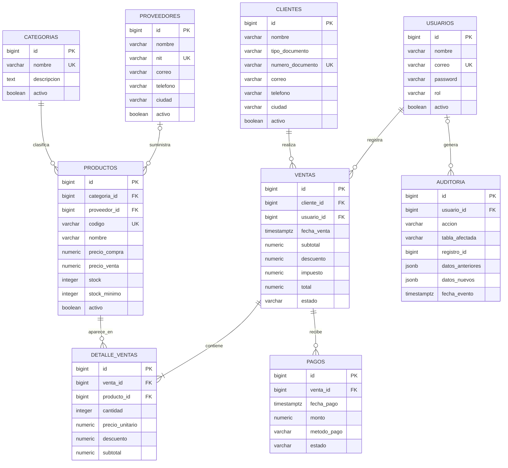

# Diagrama Entidad-Relación (DER) – GestorComercial

El siguiente diagrama representa la estructura relacional de la base de datos PostgreSQL del sistema GestorComercial, alojada en Supabase.

## Descripción de las relaciones

| Relación | Cardinalidad | Descripción |
|---|---|---|
| Categorías – Productos | 1:N | Una categoría puede clasificar varios productos. |
| Proveedores – Productos | 1:N | Un proveedor puede suministrar varios productos. |
| Clientes – Ventas | 1:N | Un cliente puede realizar varias ventas. |
| Usuarios – Ventas | 1:N | Un usuario puede registrar varias ventas. |
| Ventas – Detalle de ventas | 1:N | Una venta contiene sus respectivos detalles. |
| Productos – Detalle de ventas | 1:N | Un producto puede aparecer en varios detalles de venta. |
| Ventas – Pagos | 1:N | Una venta puede tener varios pagos. |
| Usuarios – Auditoría | 1:N | Un usuario puede generar varios registros de auditoría. |

**Convenciones:**
- PK: clave primaria.
- FK: clave foránea.
- UK: campo con restricción de unicidad.
- 1:N: relación uno a muchos.